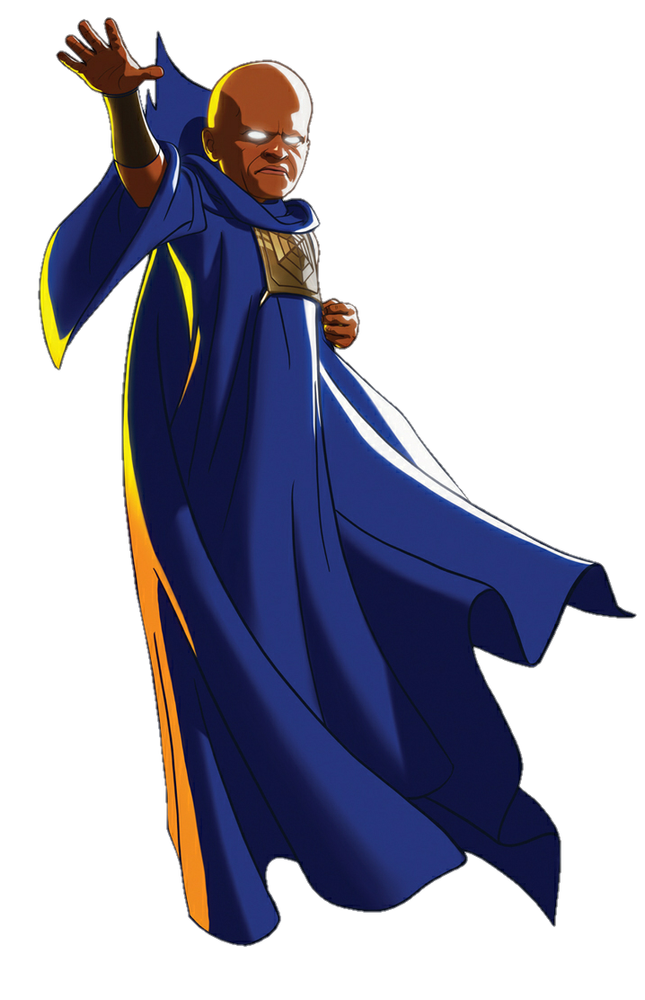

# The Watcher



A fully local, zero-cost app that watches your webcam and narrates your very
ordinary life like a deadly-serious nature documentary. Since I love Marvel, the project is named as The Watcher because he just watches stuff and narrates things to us by breaking the fourth wall.

No API keys. No paid services. No billing accounts. Runtime works offline.

## How it works

```
Browser webcam ──frame every 3–12s──▶ FastAPI /api/analyze
                                          │
                              [ local vision model: gemma3:4b ]
                                          │  factual observation
                              [ same local model: gemma3:4b ]
                                          │  documentary caption
              caption + dedupe + cooldown ▼
Browser 9:16 preview ◀──── caption JSON ──┘

Optional spoken narration: local neural TTS (Kokoro-82M) ──▶ WAV ──▶ <audio>
```

- **Vision** and **narration** are separate model calls so a bad vision read
  cannot ruin the writing style, and so the narration prompt stays tunable.
  The *same* model is reused for both to avoid loading two large models on
  low-RAM machines.
- Frames are captured in the browser, sent over `localhost`, analysed in
  memory, and discarded. Nothing is uploaded and nothing is written to disk
  unless you explicitly enable debug frames.
- All inference runs through a local [Ollama](https://ollama.com/) server.

## Hardware note (read this)

This project was selected for the machine it was built on: **Apple M1, 8 GB
unified memory, macOS, Metal GPU**. On 8 GB the practical budget is roughly
3–4 GB of model weights, so the defaults are deliberately small and fast:

| Role | Default model | Size | Why |
|------|---------------|------|-----|
| Vision | `gemma3:4b` | ~3.3 GB | Accurate, literal descriptions; current, well-supported VLM |
| Narration | `gemma3:4b` | (same) | Reused from the vision pass — only one model stays in RAM |
| Speech | `Kokoro-82M` (local neural TTS) | ~330 MB | Natural, human-sounding voice; runs on CPU (~0.3× realtime) |

One 3.3 GB model fits comfortably in the ~5.3 GB Metal budget and leaves room
for the OS, so nothing swaps to disk. Measured on this M1: cold load ≈ 10 s
once, then vision ≈ 1.6 s and narration ≈ 1 s per caption; speech synthesis is
~2 s for a typical sentence and does not touch the GPU.

Models evaluated for the 8 GB budget (all run locally via Ollama):

| Model | Vision quality | Warm speed | Verdict |
|-------|----------------|-----------|---------|
| `gemma3:4b` | Good | ~1.6 s | **chosen default** |
| `moondream` (~1.7 GB) | weak on people, sometimes empty | ~2–5 s | lighter fallback |
| `qwen2.5vl:3b` (~3.2 GB) | excellent | ~30 s (swaps on 8 GB) | too slow here |

If you have **more** RAM you can move to a bigger model, e.g.
`VISION_MODEL=qwen2.5vl:7b NARRATOR_MODEL=gemma3:12b ./run.sh`.
On **less** than 8 GB, use `VISION_MODEL=moondream NARRATOR_MODEL=llama3.2:3b`.

The app was tested end to end on the M1 8 GB machine above.

## Requirements

- macOS (for the built-in `say`/`afconvert` speech; captions still work
  without it via browser speech synthesis)
- Python 3.11+ (`python3.12` recommended)
- [Ollama](https://ollama.com/) (`brew install ollama`)
- A webcam (built-in FaceTime HD works)
- A modern browser (Chrome, Safari, or Firefox)

Ollama is the only thing you install by hand. Everything else is handled by
`run.sh`.

## Install & run (one command)

```bash
brew install ollama          # only if you don't already have it
./run.sh
```

`run.sh` will:

1. create a `.venv` and install Python dependencies,
2. start `ollama serve` if it isn't running,
3. download the models on first run (needs internet **once**),
4. launch the server and open <http://127.0.0.1:8765>.

The first run downloads the Ollama models (~3.3 GB) **and** the Kokoro voice
model (~350 MB, into `models/tts/`). After that it runs fully offline.

If you don't want the auto-open, ignore the browser tab. To run manually
after the first setup:

```bash
source .venv/bin/activate
python -m uvicorn backend.main:app --host 127.0.0.1 --port 8765
```

### First-run permission

The first time you press **Start**, the browser asks for camera access. Allow
it. The preview is mirrored so it feels natural.

## Recording a Reel

1. `./run.sh`
2. Open <http://127.0.0.1:8765>.
3. Wait for the status badge to say **LIVE** (top of the frame).
4. Position your laptop so the 9:16 frame shows you naturally.
5. Press **Start**. Sit and behave badly-but-visibly (drink water, scroll,
   stare at the IDE).
6. In OBS, add a **Window Capture** of the browser (or a **Display Capture**)
   and record a vertical canvas. The caption sits in the side gutter, so the
   clean 9:16 frame stays free of text — capture the whole window, not just
   the frame.
7. Press **Pause**/**Resume** to control when it narrates; **Stop** ends the
   session.
8. Edit the best captions into your Reel.

The narration appears as a pixel dialogue box docked beside the frame; use the
**Caption side** control to flip it left or right to suit your crop. Captions
are plain, readable text in the bundle theme.

## UI controls

- **Start / Pause / Resume / Stop** — session and camera control. Pause freezes
  captioning but keeps the live preview.
- **Subject's situation** — the work you're ignoring (e.g. *"three assignments
  due, still scrolling"*). This fuels the running joke: the narrator contrasts
  how peaceful you look with everything left undone. Editable live.
- **Observation interval** — how often a frame is analysed (3–12 s).
- **Narration frequency** — minimum gap before a new caption is allowed
  (Sparse ≈ 20 s, Balanced ≈ 6 s, Chatty ≈ 2 s). Repeated scenes are suppressed
  regardless.
- **Caption side** — dock the narration dialogue box to the left or right of
  the video frame (keeps the 9:16 frame clean).
- **Narrator voice** — which local neural voice to use (default `bm_george`, a
  British documentary narrator; 54 voices available — see **Voice** below).
- **Spoken narration** — speak each caption out loud using the local neural
  TTS (falls back to browser speech synthesis if no engine is available).
- **Show caption history** — rolling list of accepted captions.
- **Observer notes** — the raw factual observation, for debugging prompts.
- **Clear history** — wipes the on-screen history and the backend's memory of
  recent observations/captions.

## Voice

Speech is generated locally with [Kokoro-82M](https://huggingface.co/hexgrad/Kokoro-82M)
(Apache-2.0) through `kokoro-onnx` — a neural model, so it sounds markedly more
human than macOS `say`. The model file lives in `models/tts/` and is downloaded
once by `run.sh`.

- Default voice: **`bm_george`** (British male, documentary register).
- Other documentary-ish picks: `bm_lewis`, `bm_fable`, `bm_daniel` (British
  male), `am_michael`, `am_onyx`, `am_fenrir` (American male).
- Voice naming: `af_`/`am_` = American female/male, `bf_`/`bm_` = British
  female/male. Pick any from the dropdown; the `[kokoro]` tag shows the engine.
- Speed is `TTS_SPEED` (default `0.92`, slightly slowed for gravitas).

If the Kokoro files are missing, or `kokoro-onnx` is not installed, the app
falls back to macOS `say` automatically, and then to the browser's built-in
speech synthesis if `say` is also unavailable.

## Configuration

All settings are environment variables with sensible defaults
(see `backend/config.py`):

| Variable | Default | Purpose |
|----------|---------|---------|
| `VISION_MODEL` | `gemma3:4b` | Ollama vision model |
| `NARRATOR_MODEL` | `gemma3:4b` | Ollama narration model |
| `OLLAMA_HOST` | `http://127.0.0.1:11434` | Ollama server |
| `PORT` | `8765` | Web server port |
| `VISION_TIMEOUT` / `NARRATION_TIMEOUT` | `120` | Per-call seconds |
| `VISION_SEED` | `42` | Fixed seed → identical frames give identical observations |
| `FRAME_DIFF_THRESHOLD` | `3.5` | Mean pixel diff below which a frame is "unchanged" |
| `SIMILARITY_THRESHOLD` | `0.72` | When two descriptions count as "no change" |
| `DEFAULT_MIN_GAP` | `4` | Default caption cooldown (UI overrides) |
| `NARRATOR_CONTEXT` | intern-with-deadlines blurb | Default "subject's situation" (UI overrides) |
| `TTS_ENGINE` | `auto` | `auto`, `kokoro` (neural), or `say` (macOS) |
| `TTS_VOICE` | `` (engine default) | Voice name; Kokoro default `bm_george`, `say` default `Daniel` |
| `TTS_SPEED` | `0.92` | Speaking rate (Kokoro speed / `say` words-per-minute) |
| `KOKORO_MODEL_DIR` | `models/tts` | Where the Kokoro `.onnx` + voices live |
| `SAVE_DEBUG_FRAMES` | `false` | Write analysed frames to `debug_frames/` |
| `OLLAMA_KEEP_ALIVE` | `5m` | How long models stay loaded |

Example:

```bash
DEFAULT_MIN_GAP=8 TTS_VOICE=am_michael FRAME_DIFF_THRESHOLD=5 ./run.sh
```

## The humour

The running joke is the gap between how calm you look on camera and all the
work piling up out of frame. Two knobs shape it:

- **Subject's situation** (UI field, or `NARRATOR_CONTEXT`) — what you're
  ignoring. Make it real for you: *"two deadlines tonight, rewatching the same
  reel"*, *"thesis chapter untouched, deep in the group chat"*.
- **`prompts/narrator_prompt.txt`** — the narrator persona and tone. It casts
  the intern as *master*, narrates his day like a main character, and hard-codes
  the line to deliver whenever a mobile phone appears. Edit or extend it freely.

The prompts are plain text; edit and restart. You can also override the whole
narrator prompt inline with the `NARRATOR_PROMPT` env var.

## Testing

```bash
source .venv/bin/activate
python -m unittest discover -s tests -v
```

The unit tests use a fake model client to cover caption generation, dedupe,
cooldown, `NO_OBSERVATION`/`NO_CAPTION` handling, busy-lock behaviour, error
handling, and reset. Models are verified live via the app's `/api/health`
endpoint and the status badge in the UI.

## Troubleshooting

- **Status shows "Ollama offline"** — start it: `ollama serve`, then reload.
- **Status shows "missing model: X"** — `ollama pull X` (e.g.
  `ollama pull gemma3:4b`).
- **"Webcam permission denied"** — allow camera access for
  `http://127.0.0.1:8765` in your browser's site settings, then Start again.
- **"The webcam is already in use"** — close other apps using the camera
  (Zoom, Photo Booth, etc.).
- **First caption is slow / empty** — the first call cold-loads the model;
  subsequent calls are ~2–3 s. An empty vision read is retried on the next tick.
- **Captions are repetitive** — lower `SIMILARITY_THRESHOLD`? No: *raise*
  `DEFAULT_MIN_GAP` or pick **Sparse**, and make sure `narrator_prompt.txt`
  still ends with the `NO_CAPTION` instruction.
- **Want better quality** — use larger models via `VISION_MODEL` /
  `NARRATOR_MODEL` if you have more RAM.
- **Voice sounds robotic** — you're on the `say` fallback. Make sure
  `models/tts/kokoro-v1.0.onnx` and `voices-v1.0.bin` exist and
  `kokoro-onnx` is installed; `TTS_ENGINE=kokoro` forces it. Check
  `/api/config` → `"tts_engine"` says `kokoro`.
- **Voice is slow or crackly** — try a shorter `DEFAULT_MIN_GAP`, or set
  `TTS_SPEED=1.0`. Synthesis is CPU-only and never competes with the GPU
  models.
- **Pixel fonts look broken** — the fonts are bundled in
  `frontend/fonts/`; hard-refresh (Cmd-Shift-R) if a stale cache is served.

## Privacy

Frames live only in browser memory and in the FastAPI process for the few
seconds it takes to describe them. They are never saved, uploaded, or sent to
any cloud service. The only network use is the one-time model download and the
loopback (`127.0.0.1`) connection between the browser and the local server.

## Project layout

```
narrator/
├── run.sh                 # single startup command
├── requirements.txt
├── backend/
│   ├── main.py            # FastAPI app, routes, static serving
│   ├── config.py          # env-driven settings
│   ├── ollama_client.py   # async Ollama client
│   ├── pipeline.py        # vision → narration, dedupe, cooldown, locking
│   └── tts.py             # Kokoro neural TTS (+ macOS `say` fallback)
├── frontend/
│   ├── index.html
│   ├── styles.css         # cozy pixel-game theme
│   ├── fonts/             # bundled OFL pixel fonts (offline)
│   └── app.js             # webcam capture loop, controls, captions
├── models/
│   └── tts/               # Kokoro model (downloaded once by run.sh)
├── prompts/
│   ├── narrator_prompt.txt
│   └── vision_prompt.txt
└── tests/
    └── test_pipeline.py
```
